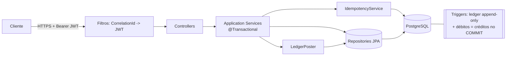

# Core Banking – Contas e Transações

API REST de core banking com **ledger de dupla entrada**, **transações ACID**, **controle de concorrência** e **idempotência**.

**Stack:** Java 21 · Spring Boot 4.0 · Spring Security + JWT · JPA/Hibernate · PostgreSQL 16 · Flyway · Docker · Testcontainers

Projeto acadêmico de demonstração. Política de segurança e limitações conhecidas em [SECURITY.md](SECURITY.md).

## Sumário
- [Como rodar](#como-rodar)
- [Estrutura do projeto](#estrutura-do-projeto)
- [Arquitetura](#arquitetura)
- [Ledger de dupla entrada](#ledger-de-dupla-entrada)
- [Decisões técnicas](#decisões-técnicas)
- [API (exemplos curl)](#api-exemplos-curl)
- [Testes](#testes)
- [Premissas](#premissas)
- [Trade-offs e limitações](#trade-offs-e-limitações)

## Como rodar

### Tudo em Docker (app + Postgres)
```bash
cp .env.example .env        # preencha DB_PASSWORD e JWT_SECRET (>= 32 bytes); sem eles o compose não sobe
# gerar valores: openssl rand -hex 24   (DB_PASSWORD)  ·  openssl rand -base64 48   (JWT_SECRET)
docker compose up --build
```
- Interface web de demonstração: <http://localhost:8080> · Swagger UI: <http://localhost:8080/swagger-ui.html>
- Health: `/actuator/health` (liveness/readiness em `/actuator/health/liveness|readiness`)
- As portas são publicadas só em `127.0.0.1` (acesso apenas da própria máquina).
- O PostgreSQL só aplica `DB_PASSWORD` na criação do volume. Se trocar a senha depois, rode `docker compose down -v` (apaga os dados) antes de subir de novo.

### Desenvolvimento local
```bash
docker compose up -d postgres      # só o banco
./mvnw spring-boot:run             # ou: mvn spring-boot:run  (perfil dev é o padrão)
```

### Testes
Precisam de Docker em execução (Testcontainers sobe um PostgreSQL real).
```bash
mvn verify        # testes unitários + integração + relatório/gate de cobertura JaCoCo
```
Relatório de cobertura: `target/site/jacoco/index.html`.

> Sem acesso ao socket do Docker (ex.: rodando o Maven dentro de um container no Docker Desktop/Windows)? Aponte para um PostgreSQL **vazio** já em execução e o Testcontainers não é usado:
> `TEST_DB_URL=jdbc:postgresql://host:5432/corebanking TEST_DB_USER=... TEST_DB_PASSWORD=... mvn verify`

### Configuração (variáveis de ambiente, perfil `prod`)
| Variável | Descrição |
|---|---|
| `DB_URL`, `DB_USER`, `DB_PASSWORD` | Conexão com o PostgreSQL |
| `JWT_SECRET` | Segredo HS256, **mínimo 32 bytes** (a aplicação não sobe sem ele) |
| `CHECKING_OVERDRAFT_LIMIT` | Limite de cheque especial da conta corrente (padrão `0.00`) |
| `SWAGGER_ENABLED` | Liga o Swagger UI e `/v3/api-docs` no perfil `prod` (padrão `false`; o compose usa `true` para demonstração) |

Perfis: `dev` (padrão; sem `JWT_SECRET` gera um segredo aleatório a cada start), `test` (Testcontainers), `prod` (tudo via env, logs JSON/ECS).

## Estrutura do projeto
```
src/main/java/com/corebanking
├── api/                    # camada HTTP
│   ├── controller/         #   Auth, Account, Transfer
│   ├── dto/                #   records de request/response (entidades JPA nunca saem na API)
│   ├── exception/          #   @RestControllerAdvice -> ProblemDetail (RFC 7807)
│   └── validation/         #   @CPF (Bean Validation)
├── application/            # casos de uso (regras de orquestração e transação)
│   ├── TransactionService  #   depósito, saque, transferência (ACID + locks + idempotência)
│   ├── LedgerPoster        #   gera lançamentos balanceados de dupla entrada
│   ├── IdempotencyService  #   Idempotency-Key
│   ├── AccountService, StatementService, ReconciliationService, AuthService
│   └── MaintenanceJobs     #   TTL das chaves + reconciliação agendada
├── domain/                 # entidades e regras puras (Account, LedgerEntry, Money, Cpf...)
│   └── exception/          #   BusinessException + ErrorCode
└── infrastructure/         # repositórios, segurança (JWT), config, logging (correlation-id)
src/main/resources/db/migration   # Flyway: V1 schema · V2 conta CAIXA · V3 triggers do ledger
src/test/java/com/corebanking     # unit/ e integration/ (Testcontainers)
```
> Pragmatismo: os DTOs ficam em `api.dto` e são usados também pelos serviços; em um sistema maior, valeria separar *commands/results* da camada de aplicação.

## Arquitetura


## Ledger de dupla entrada
Cada operação gera uma `transactions` (o fato de negócio) e **dois lançamentos** em `ledger_entries` (um DEBIT e um CREDIT de mesmo valor). O saldo **não é apenas atualizado**: ele é *derivável* do ledger.

Convenção: **saldo = Σ créditos − Σ débitos**. Existe uma conta contábil interna **CAIXA** (`id = 1`) que é a contrapartida de depósitos e saques.

```
Depósito  100:  DEBIT  CAIXA            100        Saque 40:   DEBIT  Conta do cliente   40
                CREDIT Conta do cliente 100                    CREDIT CAIXA               40

Transferência 30:  DEBIT  Conta A  30
                   CREDIT Conta B  30
```
Consequência: a **soma dos saldos de todas as contas (incluindo CAIXA) é sempre 0** — invariante verificado nos testes de concorrência.

Garantias em camadas:
1. **Aplicação:** `LedgerPoster` assegura débitos == créditos antes de gravar.
2. **Banco (V3):** `CONSTRAINT TRIGGER ... DEFERRABLE INITIALLY DEFERRED` recusa no `COMMIT` qualquer transação desbalanceada; triggers `BEFORE UPDATE OR DELETE` tornam `ledger_entries` e `transactions` **append-only**. Entidades JPA são `@Immutable`.
3. **Saldo materializado:** `accounts.balance` existe por performance. `GET /accounts/{id}/reconciliation` e o job `MaintenanceJobs.reconcile` (cron diário, loga `ERROR` em divergência) comparam o saldo com o ledger.
4. **Estornos** são novos lançamentos compensatórios (`TransactionType.REVERSAL` reservado); nunca editam o original.

## Decisões técnicas

### ACID
Cada caso de uso é um único `@Transactional`: validação → chave de idempotência → locks → débito → crédito → lançamentos. Qualquer exceção reverte **tudo**. `AtomicityIntegrationTest` prova: com falha injetada no lançamento de crédito, o saldo, a transação, o lançamento do débito *e a chave de idempotência* são revertidos.

### Concorrência: lock pessimista + `@Version`
- **Lock pessimista** (`SELECT ... FOR UPDATE`, timeout de 5 s) nas contas envolvidas, **sempre em ordem crescente de id**. Duas transferências cruzadas (A→B e B→A) disputam os locks na mesma ordem, logo **não há deadlock**. O CAIXA tem o menor id e é sempre bloqueado primeiro.
- **Por que pessimista e não só otimista?** Contas quentes têm contenção real; com otimista, N transações concorrentes causam N−1 retries/falhas visíveis ao cliente. O lock pessimista serializa e todas completam (ou falham por saldo, uma regra de negócio legítima).
- **`@Version` como segunda barreira:** se algum caminho de código futuro atualizar uma conta sem lock, o conflito vira `ObjectOptimisticLockingFailureException` → HTTP 409 (`CONCURRENT_UPDATE`) em vez de *lost update* silencioso.
- Além disso, `CHECK (balance >= -overdraft_limit)` no banco é a última barreira contra saldo negativo.

### Idempotência (`Idempotency-Key`)
Obrigatório em depósito, saque e transferência (ausente → 400 `IDEMPOTENCY_KEY_MISSING`). Tabela `idempotency_keys` com `UNIQUE (owner_id, idem_key)` — a chave é **escopada por cliente**.
1. `INSERT ... ON CONFLICT DO NOTHING` **na mesma transação** da operação financeira.
2. Inseriu → executa e grava a resposta junto da chave; commit atômico.
3. Não inseriu → mesmo hash do payload: **devolve a resposta original** (header `Idempotent-Replayed: true`), sem reprocessar; hash diferente: **422** `IDEMPOTENCY_KEY_REUSED`.
4. **Requisições concorrentes com a mesma chave: estratégia de ESPERA.** O Postgres bloqueia o segundo `INSERT` até a primeira transação confirmar/reverter; então ele devolve a resposta original (ou executa, se a primeira falhou). Há teste com 10 threads simultâneas: 1 execução, 9 replays.
5. Se a operação falha (ex.: saldo insuficiente), o rollback desfaz também a chave: o retry reprocessa normalmente.
6. **TTL:** job remove chaves com mais de 24 h (`bank.idempotency.ttl`).

### Valores monetários
`BigDecimal` em todo o código, `NUMERIC(19,2)` no banco, nenhum `double/float`. Entradas com mais de 2 casas decimais são **rejeitadas** (nunca arredondadas silenciosamente); `RoundingMode` é sempre explícito (`Money`).

### Segurança
- JWT HS256 stateless com expiração (60 min), senhas com BCrypt, mitigação de *user enumeration* no login (hash de tempo equivalente).
- **Freio a força bruta no login:** 10 falhas por e-mail ou 30 por IP em 15 min bloqueiam novas tentativas (**429** `TOO_MANY_ATTEMPTS`).
- **Corpo de requisição limitado a 16 KiB** (**413** `PAYLOAD_TOO_LARGE`) e cabeçalhos de segurança (CSP, `Referrer-Policy`, `X-Content-Type-Options`, `X-Frame-Options`, `Permissions-Policy`).
- Cada cliente só acessa as próprias contas (**403**); conta inexistente → 404. Contas de origem exigem ser do solicitante; o destino pode ser de terceiros.
- Segredos só por variável de ambiente (nenhum valor padrão no repositório); CPF mascarado em respostas e logs; senhas/tokens nunca logados.
- Correlation-id (`X-Correlation-Id`) em todo log e em todo erro (`correlationId` no ProblemDetail).

### Erros (RFC 7807)
```json
{ "type": "about:blank", "title": "Saldo insuficiente", "status": 422,
  "detail": "Saldo insuficiente", "code": "INSUFFICIENT_FUNDS", "correlationId": "..." }
```
Códigos: `VALIDATION_ERROR`, `INVALID_AMOUNT`, `INVALID_PERIOD`, `IDEMPOTENCY_KEY_MISSING`, `IDEMPOTENCY_KEY_REUSED`, `INVALID_CREDENTIALS`, `UNAUTHENTICATED`, `ACCESS_DENIED`, `ACCOUNT_NOT_FOUND`, `ACCOUNT_NOT_ACTIVE`, `INSUFFICIENT_FUNDS`, `SAME_ACCOUNT_TRANSFER`, `DUPLICATE_CPF`, `DUPLICATE_EMAIL`, `CONCURRENT_UPDATE`, `PAYLOAD_TOO_LARGE`, `TOO_MANY_ATTEMPTS`.

## API (exemplos curl)
Base: `/api/v1`. Coleção pronta em [requests.http](requests.http) e documentação interativa no Swagger UI.

```bash
H=http://localhost:8080/api/v1

# Cadastro e login
curl -s -X POST $H/auth/register -H 'Content-Type: application/json' \
  -d '{"name":"Maria Silva","email":"maria@example.com","password":"senha-forte-123","cpf":"529.982.247-25"}'
TOKEN=$(curl -s -X POST $H/auth/login -H 'Content-Type: application/json' \
  -d '{"email":"maria@example.com","password":"senha-forte-123"}' | jq -r .accessToken)

# Abrir contas (CORRENTE | POUPANCA)
curl -s -X POST $H/accounts -H "Authorization: Bearer $TOKEN" -H 'Content-Type: application/json' -d '{"type":"CORRENTE"}'
curl -s -X POST $H/accounts -H "Authorization: Bearer $TOKEN" -H 'Content-Type: application/json' -d '{"type":"POUPANCA"}'
curl -s $H/accounts -H "Authorization: Bearer $TOKEN"                       # listar minhas contas
curl -s $H/accounts/1000 -H "Authorization: Bearer $TOKEN"                  # detalhes

# Depósito / saque  (Idempotency-Key obrigatório)
curl -s -X POST $H/accounts/1000/deposits -H "Authorization: Bearer $TOKEN" \
  -H 'Idempotency-Key: dep-0001' -H 'Content-Type: application/json' \
  -d '{"amount":1000.00,"description":"Depósito inicial"}'
curl -s -X POST $H/accounts/1000/withdrawals -H "Authorization: Bearer $TOKEN" \
  -H 'Idempotency-Key: saq-0001' -H 'Content-Type: application/json' -d '{"amount":100.50}'

# Transferência (repita o MESMO comando: resposta idêntica, sem duplicar)
curl -si -X POST $H/transfers -H "Authorization: Bearer $TOKEN" \
  -H 'Idempotency-Key: trf-0001' -H 'Content-Type: application/json' \
  -d '{"sourceAccountId":1000,"targetAccountId":1001,"amount":250.00,"description":"Reserva"}'

# Saldo, extrato paginado com período e reconciliação
curl -s $H/accounts/1000/balance -H "Authorization: Bearer $TOKEN"
curl -s "$H/accounts/1000/statement?from=2026-01-01&to=2026-12-31&page=0&size=10" -H "Authorization: Bearer $TOKEN"
curl -s $H/accounts/1000/reconciliation -H "Authorization: Bearer $TOKEN"
```

| Método | Rota | Descrição |
|---|---|---|
| POST | `/auth/register`, `/auth/login` | Cadastro (CPF validado) e JWT |
| POST/GET | `/accounts`, `/accounts/{id}` | Abrir / listar / consultar conta |
| GET | `/accounts/{id}/balance` | Saldo e saldo disponível |
| POST | `/accounts/{id}/deposits` · `/withdrawals` | Depósito e saque (`Idempotency-Key`) |
| POST | `/transfers` | Transferência entre contas (`Idempotency-Key`) |
| GET | `/accounts/{id}/statement?from&to&page&size` | Extrato paginado (datas ISO, UTC, inclusivas; `size` ≤ 100) |
| GET | `/accounts/{id}/reconciliation` | Saldo materializado × ledger |

## Testes
| Suíte | O que prova |
|---|---|
| `CpfTest`, `MoneyTest`, `AccountTest`, `LedgerPosterTest`, `JwtServiceTest`, `LoginAttemptLimiterTest` | Regras de domínio, dígitos do CPF, BigDecimal, lançamentos balanceados, JWT (inclui `alg=none`), freio de login |
| `SecurityHardeningIntegrationTest` | Bloqueio de login (429), corpo grande (413), datas absurdas no extrato (400), cabeçalhos de segurança, reconciliação de conta alheia (403) |
| `BankingFlowIntegrationTest` | Fluxo completo via HTTP: extrato (filtro/paginação), 401/403/404, validações, retry idempotente, payload divergente (422), CPF/e-mail duplicados |
| `AtomicityIntegrationTest` | **Rollback atômico** com falha injetada no crédito; ledger append-only; trigger de balanceamento no COMMIT |
| `ConcurrencyIntegrationTest` | 300 transferências cruzadas em 8 threads (sem deadlock, sem saldo negativo, total preservado); 20 saques disputando 100,00; 10 requisições simultâneas com a mesma chave |
| `MaintenanceIntegrationTest` | TTL das chaves e detecção de divergência na reconciliação |

`mvn verify` aplica gate JaCoCo de **≥ 80% de linhas** em `domain` e `application`.

## Premissas
- **Moeda única** (BRL), sem câmbio. Valor máximo por operação: 15 dígitos inteiros.
- **Cheque especial:** limite único e configurável (`CHECKING_OVERDRAFT_LIMIT`, padrão 0) aplicado a toda conta corrente nova; poupança nunca negativa.
- **Depósito e saque** só em contas do próprio cliente autenticado (simula operação em canal próprio; não há "depósito de terceiros").
- **Destino de transferência** identificado pelo `id` da conta; pode ser de outro cliente. Transferir para a conta contábil CAIXA é bloqueado.
- **Um cliente ↔ um usuário**; o CPF é único por cliente, o e-mail é único e case-insensitive.
- **Datas do extrato** interpretadas em UTC; `from`/`to` inclusivos.
- **TTL da idempotência:** 24 h; chave escopada por cliente.
- **Sem papéis/administração:** não há endpoint de bloqueio/encerramento de conta nem de estorno (o modelo e o ledger já suportam `BLOQUEADA`/`ENCERRADA` e `REVERSAL`).
- Nenhum dado sensível (senha, token, CPF completo) é registrado em log.

## Trade-offs e limitações
- **CAIXA é um ponto de serialização:** todo depósito/saque bloqueia a mesma linha. Simples e correto, mas limita a vazão de depósitos/saques. Mitigação possível: várias sub-contas de caixa (sharding por hash da conta) sem alterar o modelo.
- **Saldo materializado + ledger** duplica informação em troca de leitura O(1); a reconciliação existe justamente para detectar divergências.
- **Resposta idempotente armazenada como texto JSON** (simples e portável); em escala, considerar `jsonb` e particionamento/expiração mais agressiva.
- **Extrato por `OFFSET`:** adequado a este escopo; para históricos enormes, trocar por paginação *keyset* (`created_at, id`).
- **Segredo JWT simétrico (HS256):** suficiente para um único serviço; com múltiplos consumidores, preferir RS256/JWKS e rotação de chaves. Não há *refresh token* nem revogação.
- **Rate limit só no login e em memória** (por instância); operações autenticadas não têm limite de frequência. Em produção, complemente no gateway.

## Licença
MIT. Veja [LICENSE](LICENSE).
